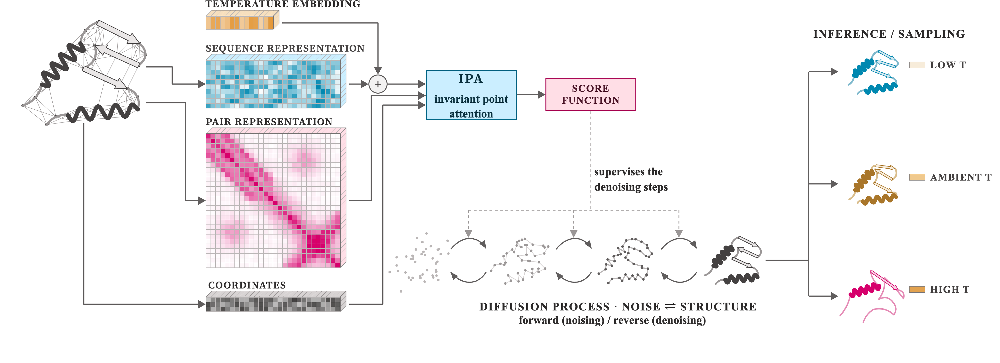

# Tempformer

**A temperature-conditioned diffusion model for generating full-atom protein conformational ensembles.**

Tempformer generates heavy-atom structural ensembles of a protein at a user-specified temperature. It is an SE(3) diffusion model: residue frames (translations and rotations) and side-chain χ angles are denoised jointly by a stack of Invariant Point Attention (IPA) layers, conditioned on per-protein embeddings (AlphaFold/ColabFold by default, or ESM-2 / DCA) and on the temperature. It is trained jointly across the five temperatures (320–450 K) of the [mdCATH](https://github.com/compsciencelab/mdCATH) dataset.

<p align="center">
  
</p>

## Key results

- **Fluctuation amplitudes (RMSF)** across 250 mdCATH test proteins recover experimental/MD-consistent trends at every temperature, with an AlphaFold > DCA > ESM-2 conditioning hierarchy.
- **Secondary structure** decays non-uniformly along the sequence with temperature, tracking coevolutionary contact stability rather than a single global "disorder" parameter.
- **TICA / folding-funnel projections** for twelve fast-folding proteins, evaluated at their correct MD simulation temperature, show generated ensembles redistributing into MD-supported high-free-energy basins at high temperature.
- **Relative thermostability rankings** (Q = 0.4 native-contact threshold, 51-protein benchmark) correlate with experimental melting temperatures (r = 0.52) and correctly order mesophile/hyperthermophile and point-mutant pairs, despite a systematic high bias from finite-simulation training data.
- **Enzyme I (EI) allostery** is reported as a boundary result: Tempformer captures static multidomain flexibility but not the domain-selective, interdomain coupling that drives genuine allosteric switching — a gap attributed to training on predominantly short, single-domain trajectories.

## Model

**Inputs.** ColabFold single and pair representations (a random rank 1–5 per training sample), amino-acid identity, a relative-position bias, and the Cα distance map of the AlphaFold rank_001 model as template pair features. Two alternative conditionings swap the embeddings:

- **ESM-2** (650M): last-layer residue representation as the single input and the 20 last-layer attention maps as the pair input.
- **DCA**: mean-field direct information as the pair input, expanded into RBF bins.

**Diffusion.** Continuous time *t* ∈ (0.001, 1] with variance-exploding schedules on the same *t* for:

- translations: Gaussian, σ from 0.1 to 35 Å;
- rotations: IGSO(3), σ from 0.02 to 1.65;
- side-chain χ1–χ4: wrapped normal on the circle, σ from 0.03 to π. χ angles with π periodicity are handled.

**Conditioning.** A conditioning vector *c* = MLP(*t*) + MLP(*T*) modulates every IPA layer through adaLN-Zero (zero-initialised shift, scale and gate). It is also added to the single representation.

**Network.** 12 IPA layers (single width 768, pair width 256, 32 heads) feed five heads:

- translation and rotation scores;
- a χ score;
- a clean-structure (x₀) backbone update;
- 7 torsion angles (AlphaFold angle ResNet).

**Output.** Heavy atoms (atom14) are built from AlphaFold rigid groups. The backbone frames and ψ come from the x₀ heads. The χ angles come from the diffusion by default, so side chains vary independently of the backbone, or optionally from the torsion head.

**Loss.** Denoising score matching for frames and χ angles. At low noise (σ_tr < 2 Å) it adds all-atom FAPE, torsion and backbone-bond losses on the x₀ prediction.

**Sampling.** Reverse SDE or probability-flow ODE, with any number of steps (default 100).

## Repository structure

```
Tempformer/
├── model/
│   ├── main_model.py           # MainModel: inputs, time/temperature conditioning, noise schedules, training loss
│   ├── structure_module.py     # IPA layers with adaLN-Zero; score, x0, torsion and chi heads
│   ├── residue_geometry.py     # atom14 geometry: frames, torsions, atom placement, FAPE (AlphaFold/OpenFold conventions)
│   ├── residue_constants.npz   # residue tables exported from OpenFold, read by residue_geometry.py
│   ├── so3.py                  # IGSO(3) sampling and scores (adapted from DiffDock)
│   ├── torus.py                # wrapped-normal diffusion for side-chain chi angles
│   ├── attention.py            # attention and feed-forward blocks
│   ├── geometry.py             # quaternion / axis-angle conversions
│   ├── positional_encoding.py  # relative position bias
│   └── sampling.py             # reverse diffusion (SDE/ODE) and ensemble metrics against MD
├── data/
│   ├── dataset.py              # mdCATH frames + ColabFold embeddings -> training samples and sampling inputs
│   └── splits/                 # make_split.py, make_split_asamt.py: seed-42 train/validation FASTA splits;
│                               # make_test_split.py: held-out test domains for the 1000-domain runs
├── training/
│   ├── train.py                # train on AlphaFold (ColabFold) embeddings
│   ├── train_esm.py            # train on ESM-2 embeddings
│   └── train_dca.py            # train with DCA direct information as the pair input
├── generation/
│   ├── generate.py             # sample ensembles for any FASTA, one PDB per structure
│   └── generate_ensembles.py   # large ensembles as topology PDB + DCD (chunked, resumable, optional minimization)
├── evaluation/
│   ├── evaluate.py                     # score a checkpoint against mdCATH MD (RMSF, native contacts, SS, rotamers)
│   ├── evaluate_nmr_benchmark.py       # local flexibility and global diversity against experimental NMR ensembles
│   ├── dual_conformation_sampling.py   # prior-guided sampling on the dual-conformation (fold-switching) benchmark
│   ├── evaluate_dual_conformation.py   # score those ensembles against both experimental states
│   ├── evaluate_point_mutation.py      # point-mutation stability: ensemble changes vs experimental ΔΔG
│   ├── simplefold_nmr_benchmark.py     # SimpleFold baseline ensembles for the NMR benchmark
│   └── ss_melting_tm.py                # melting temperatures from loss of native secondary structure
├── minimizer/                  # energy minimizer from aSAM (Apache-2.0, see minimizer/LICENSE), used by --minimize
│   ├── __init__.py             # energy terms (bonds, angles, torsions, clashes) and the minimization loop
│   ├── runner.py               # Minimizer: minimizes a topology PDB + DCD ensemble in batches
│   ├── topology.py             # residue tables, atom14 <-> mdtraj conversion
│   └── params/                 # force-field parameters and the mdcath / atlas protocols
└── assets/
    └── pipeline.png
```

All scripts are run as modules from the repository root, e.g. `python -m training.train`.

## Installation

Requires Python ≥ 3.9 and PyTorch ≥ 2.3. Training needs a CUDA GPU (bf16 is used where supported). Sampling also runs on CPU, but slowly.

```bash
git clone https://github.com/Divyanshu2132/Tempformer.git
cd Tempformer
pip install torch numpy scipy h5py mdtraj pyyaml   # training, sampling and minimization
pip install pandas matplotlib biopython            # evaluation and benchmark scripts
```

[ColabFold](https://github.com/sokrypton/ColabFold) computes the input embeddings (see below). The SimpleFold baseline (`evaluation.simplefold_nmr_benchmark`) runs in a separate environment with [SimpleFold](https://github.com/apple/ml-simplefold) installed.

The first import of `model/so3.py` precomputes the IGSO(3) lookup tables once. It caches them as hidden `.so3_*.npy` files in the repository root.

## Inputs

**Embeddings.** Each protein needs its ColabFold outputs: `<name>_single_repr_rank_00K_*.npy`, `<name>_pair_repr_rank_00K_*.npy` and `<name>_unrelaxed_rank_001_*.pdb`. Run:

```bash
colabfold_batch proteins.fasta colabfold_out/ --save-single-representations --save-pair-representations
```

Sequence names in the FASTA must match the `<name>` prefix of these files.

The alternative conditionings read the following files:

- ESM-2: `single_<name>.npy` (L × 1280) and `pairwise_<name>.npy` (L × L × 20).
- DCA: `<name>_pairwise_dca.npy` (L × L × 1).

Both still take the template from the ColabFold rank_001 model unless `--no-template` is given.

**MD frames (training and MD-based evaluation only).** mdCATH HDF5 files, named `mdcath_dataset_<domain>.h5` or `mdcath_snapshots_<domain>.h5`. Snapshot files are preferred when both exist.

**Default locations.** Every path is a command-line option. The defaults are:

- `data/alphafold_embeddings/` for the training FASTA and ColabFold outputs: `train_data.fasta`, `train_embeddings/`, `val_data.fasta`, `val_embeddings/`;
- a sibling folder `../temp_sim_dataset/` for mdCATH frames (`filtered_train_data/`), ESM-2 and DCA embeddings, and the benchmark sets;
- `weights/` for checkpoints.

Embeddings, MD data, benchmark sets and trained checkpoints are not included in this repository.

## Usage

### Training

```bash
# Smoke test: build the datasets, one training step, one validation batch, one tiny sampling run
python -m training.train --check

# AlphaFold (ColabFold) conditioning
python -m training.train \
    --fasta data/splits/tempformer500_train.fasta --val-fasta data/splits/tempformer500_val.fasta \
    --embedding-path colabfold_out/ --val-embedding-path colabfold_out/ \
    --data-dirs mdcath/ --save-path weights/tempformer500_af.pth

# ESM-2 and DCA conditioning (defaults: the 500-domain split above); all training.train options apply
python -m training.train_esm --embedding-path esm_embeddings/ --val-embedding-path esm_embeddings/ \
    --template-path colabfold_out/ --data-dirs mdcath/
python -m training.train_dca --dca-path dca_embeddings/ --embedding-path colabfold_out/ \
    --val-embedding-path colabfold_out/ --data-dirs mdcath/
```

Each epoch draws fresh frames: 10 per domain and temperature, each with a random embedding rank and a random 256-residue crop. Training uses AdamW with warmup and cosine decay, an effective batch of 6 × 8 (gradient accumulation) and an EMA of the weights (decay 0.999). Every 5 epochs, ensembles for 10 validation domains are scored against MD at all five temperatures:

score = mean RMSF Pearson r − mean |Q − Q_MD| − mean per-residue SS error − χ1 rotamer error

Checkpoints:

- `weights/<name>.pth`: the best checkpoint by this score, with EMA weights and the model config;
- `weights/<name>_last.pth`: written every epoch. Training resumes from it automatically (`--no-resume` starts over).

The train/validation FASTA files are written by `data/splits/make_split.py` (`--n 500` → 400 training + 100 validation domains, `--n 1000` → 900 + 100) and `data/splits/make_split_asamt.py` (a split of the aSAMt mdCATH training set). Splits of different sizes made by the same script share the same validation domains. `data/splits/make_test_split.py` writes `tempformer1000_test250.fasta`: the next 250 domains of the same seed-42 draw, never seen by the 1000-domain runs, that have every AF, DCA and ESM-2 input and an mdCATH file.

### Sampling

```bash
# One PDB per structure: outputs/<name>_<T>/<name>_<T>_<i>.pdb
python -m generation.generate --checkpoint weights/tempformer500_af.pth \
    --fasta proteins.fasta --embedding-path colabfold_out/ \
    --temperatures 320 348 379 413 450 --num-samples 50 --steps 100 --out-dir outputs/

# Ensembles as <out-dir>/<checkpoint>_epoch<E>/<name>/<name>.<T>.{top.pdb,traj.dcd}
python -m generation.generate_ensembles --checkpoint weights/tempformer500_af.pth \
    --fasta proteins.fasta --embedding-path colabfold_out/ \
    --num-samples 1000 --chunk-size 100 --minimize --out-dir outputs/
```

- Any temperature can be requested; training covers 320–450 K.
- `--sampler ode` uses the probability-flow ODE instead of the SDE.
- `--chi-source predicted` takes χ angles from the torsion head instead of the diffusion.
- `generation.generate_ensembles` also samples ESM-2 and DCA checkpoints: `--embeddings esm --esm-path esm_embeddings/` or `--embeddings dca --dca-path dca_embeddings/`. The template still comes from `--embedding-path`. It stops if the embedding widths do not match the checkpoint.
- `--minimize` also relaxes every ensemble with the bundled energy minimizer (`minimizer/`, mdcath protocol) and writes it to `<checkpoint>_epoch<E>_min/` in the same layout. With `--no-keep-raw`, only the minimized ensembles are kept.
- `generation.generate_ensembles` is resume-safe. It can run specific (protein, temperature) pairs with `--systems NAME:T` and split the work over a job array with `--task-id` / `--num-tasks`.

### Evaluation and benchmarks

```bash
# Ensembles for validation domains, scored against mdCATH MD -> outputs/evaluation/metrics_history.csv
# (--minimize: minimized ensembles, scored into metrics_history_min.csv)
python -m evaluation.evaluate --checkpoint weights/tempformer500_af.pth --fasta data/splits/tempformer500_val.fasta \
    --embedding-path colabfold_out/ --data-dirs mdcath/ --num-domains 10 --num-samples 50

# NMR ensembles: per-residue RMSF error and ensemble-diversity error (bench: fasta/, native_ensembles/)
python -m evaluation.evaluate_nmr_benchmark --bench nmr_benchmark/ --ensembles tempformer=outputs/<run>/ \
    --out-csv nmr.csv

# Dual-conformation benchmark: sample from each experimental state, then score against the other state
python -m evaluation.dual_conformation_sampling --model tempformer --checkpoint weights/tempformer1000_af.pth \
    --bench dual_conformation_benchmark/ --out-dir dual_out/
python -m evaluation.evaluate_dual_conformation --root dual_out/ --bench dual_conformation_benchmark/ \
    --plot-dir plots/

# Melting temperatures from the loss of native secondary structure with temperature
python -m evaluation.ss_melting_tm --ens-dirs outputs/<run>/ --fasta melting.fasta --ref-dir colabfold_out/ --plot

# Point-mutation stability: each mutant's change in ensemble ΔG, Q, RMSD and native SS vs experimental ΔΔG
# (root: system_info.csv, alphafold_embeddings/ and one ensemble folder per model; the first two models are compared)
python -m evaluation.evaluate_point_mutation --root point_mutation/ --models <run> asamt --temperature 320

# SimpleFold baseline ensembles for the NMR benchmark, in the generate_ensembles layout (SimpleFold environment)
python -m evaluation.simplefold_nmr_benchmark --bench nmr_benchmark/ --cache simplefold_cache/ --out-dir simplefold_out/
```

Run any script with `--help` for its full list of options, e.g. `python -m generation.generate --help`.

## Citation

If you use this code, please cite:

<!-- ```bibtex
@article{tempformer2026,
  title   = {Tempformer: a temperature-conditioned diffusion model for protein conformational ensembles},
  author  = {TODO: author list},
  journal = {TODO: journal / preprint server},
  year    = {2026},
  note    = {Manuscript in preparation}
}
``` -->
